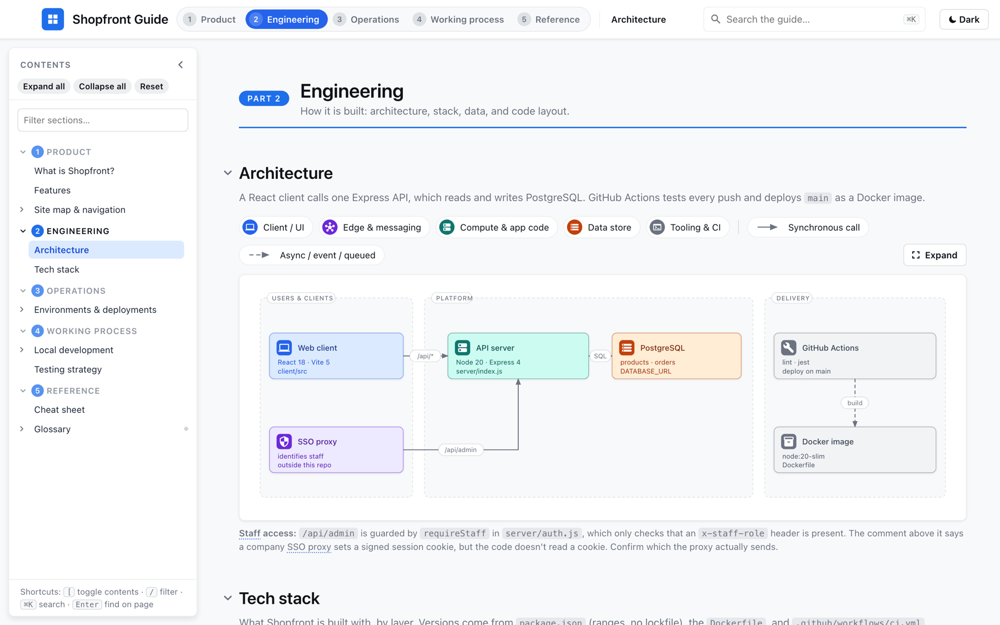
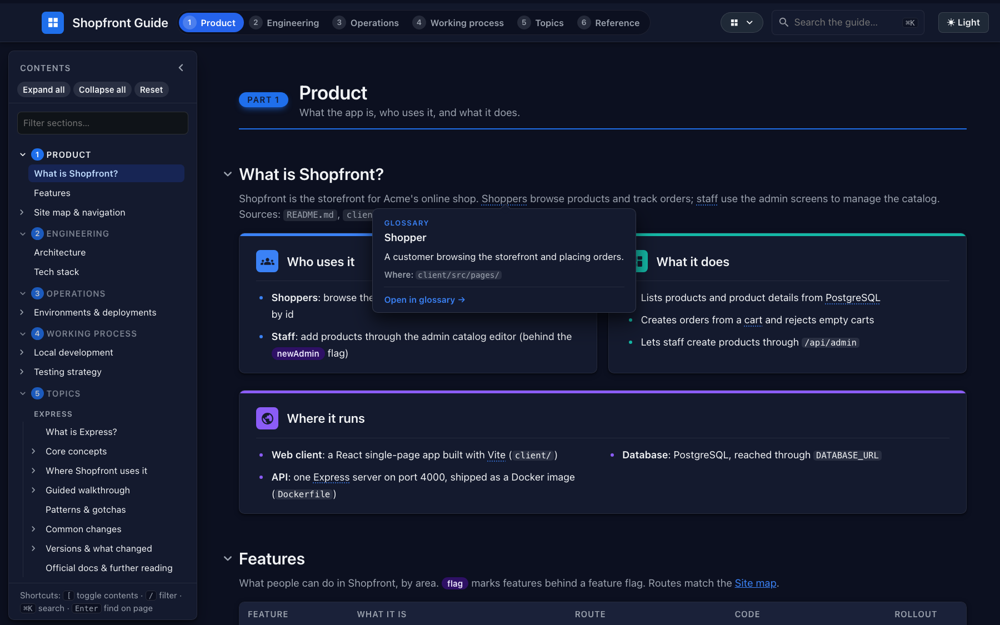
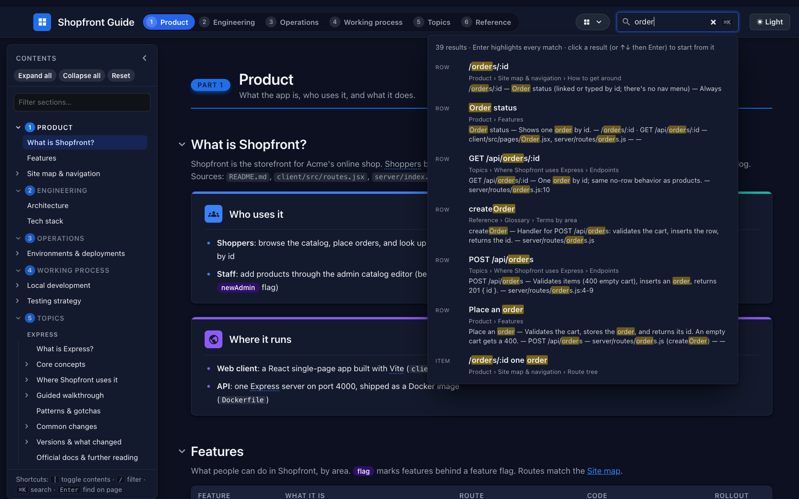

<div align="center">

# 📘 Application Explainer

**Turn any application repo into a searchable, self-contained Product & Engineering Guide, with every claim checked
against the code.**

<p>
  <a href="https://docs.claude.com/en/docs/claude-code/plugins"></a>
  <a href=".claude-plugin/plugin.json"></a>
  <a href="#requirements"></a>
  <a href="#what-it-generates"></a>
  <a href="https://github.com/SimplySylvia/Claude-Application-Explainer/actions/workflows/ci.yml"></a>
  <a href="#development"></a>
  <a href="LICENSE"></a>
  <a href="https://github.com/SimplySylvia/Claude-Application-Explainer/commits/main"></a>
</p>

**[▶ Open the live demo guide](https://simplysylvia.github.io/Claude-Application-Explainer/demo/)**

[Quick start](#quick-start) · [How it works](#how-it-works) · [What it generates](#what-it-generates) ·
[Example](#example) · [Development](#development)



</div>

## Why

New engineers and PMs spend their first weeks piecing together how an app works from READMEs, Slack threads, and
reading code. This plugin gives Claude Code a repeatable process for writing that knowledge down:

- **One file to share.** The guide is a single HTML file with no server, build step, or network access needed to
  read it.
- **Grounded in the code.** Claims cite repo paths, review agents fact-check every section, and anything that
  can't be verified is left out.
- **Safe by default.** The app repo is only ever read. The guide lives in its own folder and git repo, and Claude
  stops for your approval at every decision that matters.

## Quick start

This repo is both the plugin and a single-plugin marketplace. In Claude Code:

```
/plugin marketplace add SimplySylvia/Claude-Application-Explainer
/plugin install application-explainer@application-explainer
```

Then open Claude Code in the app repo you want documented and ask, for example:

> Build an onboarding guide for this repo for new engineers.
>
> Explain this codebase: architecture, tech stack, and how we deploy.
>
> Use the application-explainer skill on this app.

Claude confirms the scope with you, then works through the phases below.

<details>
<summary>Other ways to install</summary>

From a local clone:

```
/plugin marketplace add /path/to/application-explainer
/plugin install application-explainer@application-explainer
```

To try it without installing: `claude --plugin-dir /path/to/application-explainer`.

For agents that don't load plugins, use the kickoff prompt in
[`skills/application-explainer/PROMPT.md`](skills/application-explainer/PROMPT.md).

</details>

## How it works

Claude works through a checklist of nine phases: scope, scaffold, discover, write, review, screenshots, glossary, QA,
and share. It writes the guide itself and hands research, fact-checking, and glossary drafting to subagents
that run in parallel. It stops for your approval at each key decision, and commits the guide after every phase.

**[See the full workflow diagram and who does what →](docs/HOW-IT-WORKS.md)**

## Guardrails

- **The app repo is read-only.** Claude reports stale docs, bugs, or odd config to you instead of fixing them.
- **No secrets or personal data** in the guide. A suspected secret is reported by file and line only.
- **Claude asks before** writing anything (until you've agreed the scope), changing accounts, flags, or roles,
  going through OAuth consent, deploying or publishing, and capturing screens that might show real personal data.
- **The guide is internal.** It documents architecture and security controls, so don't publish it publicly (see
  [`references/sharing.md`](skills/application-explainer/references/sharing.md)).

## What it generates

Claude writes to a **guide folder** outside the app repo (default: a sibling `<app>-guide/`) with its own git repo.

```
<app>-guide/
├── <app>-guide.html                  # the guide: one self-contained HTML file
├── <app>-guide-no-screenshots.html   # share version without screenshots (only built when screenshots exist)
├── guide_config.py                   # title, brand color, logo, parts/pages, collapse defaults
├── sections/<id>.html                # one source file per section
├── diagrams.py                       # SVG architecture/flow diagrams
├── shots.py, screenshots/            # optional screenshot gallery
├── build/                            # build engine copied from the skill (python3 build/build.py)
├── qa/                               # qa_check.py output and glossary drafts (git-ignored)
└── README.md                         # how to rebuild, and how the guide is shared internally
```

**The HTML guide** inlines all of its CSS, JS, icons, fonts, and images, so it opens straight from disk. It has:

- **Five part pages** shown as header tabs, each with a sidebar:
  - **Product:** overview, features (grouped by area, with route, code location, and rollout flag), site map and route tree
  - **Engineering:** architecture diagram, tech stack by layer with versions
  - **Operations:** environments, URLs, and how a change reaches production (including rollback)
  - **Working process:** local dev setup and daily loop, testing strategy
  - **Reference:** cheat sheet of commands, glossary
- **Optional sections** chosen to fit the app, such as request lifecycle, auth, data model, async jobs, data
  pipeline, observability, security, and AI features. See the full catalog in
  [`references/sections.md`](skills/application-explainer/references/sections.md).
- **SVG diagrams** with a pan/zoom viewer.
- **A glossary** of domain, vendor, and internal terms. Mentions of a term link to it and show its definition on hover.
- **⌘K search** across all pages.
- **Dark and light themes.**
- **An optional screenshot gallery**, captured only from an environment with synthetic data that you've approved.
- **A footer** recording the source repo, branch, commit, and build date.

Before Claude hands the guide over, `qa_check.py` must pass on both HTML files with zero TODOs.

### Example

**[Open the live demo](https://simplysylvia.github.io/Claude-Application-Explainer/demo/)**: a complete guide for **Shopfront**, the small fictional app used by the evals
(`evals/_fixture/make-app.sh`). A real app produces more sections and longer tables. The screenshots below are
from the same guide.

<table>
  <tr>
    <td width="50%"></td>
    <td width="50%"></td>
  </tr>
  <tr>
    <td><b>Glossary hover cards:</b> underlined terms show their definition and repo path (dark theme).</td>
    <td><b>⌘K search</b> across every page; each result shows the page and section it's in.</td>
  </tr>
</table>

The Engineering page at the top of this README shows the architecture diagram in the light theme. Its caption
flags a mismatch between a code comment and what the code actually does: the kind of finding the verification
pass is there to catch.

## Requirements

- [Claude Code](https://docs.claude.com/en/docs/claude-code) with plugin support
- Python 3.9+ (build engine and scripts; standard library only)
- Google Chrome or Chromium (for `qa_check.py` and screenshots)

## Repository layout

| Path | What |
|---|---|
| `.claude-plugin/plugin.json` | Plugin manifest |
| `.claude-plugin/marketplace.json` | Marketplace manifest (lists this repo as its only plugin) |
| `skills/application-explainer/` | The skill: `SKILL.md`, build `engine/`, `starter/` template, `scripts/`, `references/` |
| `agents/` | Subagents the skill fans out to: `repo-researcher`, `structure-reviewer`, `section-verifier`, `glossary-drafter` |
| `docs/` | [`HOW-IT-WORKS.md`](docs/HOW-IT-WORKS.md) workflow and agents; `demo/` live demo and its source; `images/` README screenshots (served by GitHub Pages) |
| `evals/` | `claude plugin eval` suite: trigger, near-miss, and end-to-end cases on a small fixture app |
| `tests/` | Unit tests for the scaffold, build, diagrams, and glossary scripts |
| `.github/` | CI workflow, issue templates, and the pull request template |
| [`CHANGELOG.md`](CHANGELOG.md) · [`LICENSE`](LICENSE) | Release notes · MIT license |

## Development

### Unit tests

Fast checks on the engine and scripts (standard library only, about two seconds):

```bash
python3 -m unittest discover -s tests -t tests
```

CI runs these on every push and pull request, along with the demo build and QA. On pull requests, it also checks
that changes to `skills/` or `agents/` bump the version.

### Evals

The suite in `evals/` runs against a small fictional app that `evals/_fixture/make-app.sh` creates.

```bash
# Trigger and near-miss cases: does the skill fire when it should, and stay out of the way when it shouldn't?
claude plugin eval . --tag trigger nearmiss --scaffold

# End to end: builds a whole guide and runs QA (slow; grants the tools the build needs)
claude plugin eval . --tag e2e --scaffold --runs 1 --allow-tools Bash Write Edit
```

Run the trigger and near-miss cases after any change to the skill's `description`.

### Demo and screenshots

The live demo and the README screenshots are built from [`docs/demo/source/`](docs/demo/source/) with the current
engine. After changing the engine or the demo source, regenerate both and commit the results:

```bash
docs/demo/make-demo.sh                   # build, run QA, recapture docs/images/*.png
docs/demo/make-demo.sh --no-screenshots  # build and QA only
```

CI fails if `docs/demo/index.html` is out of date.

### Releasing

Bump `version` in `.claude-plugin/plugin.json` when you change the skill or agents, and move the `Unreleased`
notes in [`CHANGELOG.md`](CHANGELOG.md) under the new version. Users pick it up with `/plugin marketplace update`,
and the version badge above updates automatically.

## License

[MIT](LICENSE). The guides you generate document your own internal systems, so keep them internal (see
[`references/sharing.md`](skills/application-explainer/references/sharing.md)).
