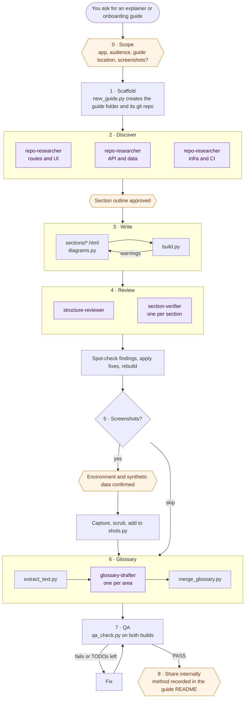

# How it works

This page describes how Claude runs the application-explainer skill. For installing and using it, see the
[README](../README.md).

## Workflow

Claude runs the skill as a checklist of nine phases. It does the writing itself and fans out to subagents for
research, review, and glossary drafting. Hexagons are points where it stops and waits for your approval.

After every phase, Claude builds the guide, commits it to the guide's own git repo, and gives you a short update.

## Who does what

| Worker | Phase | Can | Job |
|---|---|---|---|
| **Claude** (main session) | All | Read the app repo; write only in the guide folder | Runs the checklist, writes sections and diagrams, spot-checks agent findings, builds, runs QA |
| [`repo-researcher`](../agents/repo-researcher.md) | 2 · Discover | Read only | Maps one area of the repo (routes, API, data, infra, CI, tests) and returns findings with paths |
| [`structure-reviewer`](../agents/structure-reviewer.md) | 4 · Review | Read only | Reviews order, gaps, duplication, and cross-links across the whole guide |
| [`section-verifier`](../agents/section-verifier.md) | 4 · Review | Read only | Fact-checks each claim in its sections against the repo and reports wrong, stale, or missing items |
| [`glossary-drafter`](../agents/glossary-drafter.md) | 6 · Glossary | Read; write one draft file in the guide's `qa/` folder | Drafts glossary rows for one area, each with a definition and repo paths |

Each phase is described in detail in
[`references/workflow.md`](../skills/application-explainer/references/workflow.md), and the agent prompts are in
[`references/agent-prompts.md`](../skills/application-explainer/references/agent-prompts.md).
