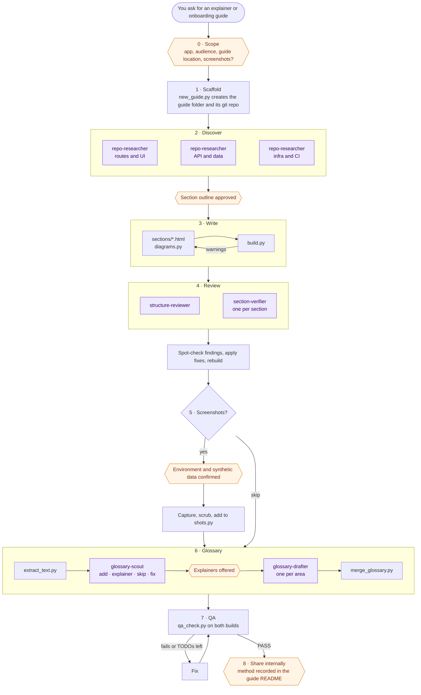
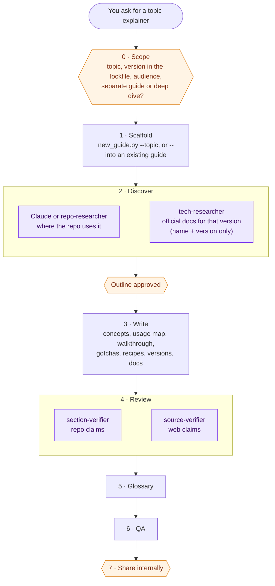

# How it works

This page describes how Claude runs the application-explainer skill. For installing and using it, see the
[README](../README.md).

## Workflow

Claude runs the skill as a checklist of nine phases. It does the writing itself and fans out to subagents for
research, review, and glossary drafting. Hexagons are points where it stops and waits for your approval.

After every phase, Claude builds the guide, updates `PROGRESS.md`, commits it to the guide's own git repo, and gives
you a short update. Each phase has **Done when** criteria in [`SKILL.md`](../skills/application-explainer/SKILL.md)
that must hold before Claude ticks it off.

`PROGRESS.md` in the guide folder holds the checklist, your scope answers, decisions (such as review findings
Claude rejected, and why), open questions, and repo problems to report. If a session ends or its context gets
summarized, the next one reads it and picks up where the last left off.

## Topic guides

The topic-explainer skill runs a shorter checklist for one technology. Claude starts it only when you ask for a
topic explainer (or run `/topic-explainer`), or say yes after it offers one.

The web research is split from the repo on purpose: `tech-researcher` and `source-verifier` are the only agents
with web tools, and they never see the repo. Their prompts carry only the technology, its version, and generic
questions.

Claude saves the research report to `research/<topic>.md` in the guide folder and spot-checks its key claims
(version facts, security fixes) by opening the cited pages. Those are public docs, and nothing from the repo goes
into the URL. Concept sections show each idea as a short, highlighted code example adapted from the docs for the
pinned version. The walkthrough quotes the real repo lines at each step and says where the flow stops if the code
doesn't run end to end.

When the repo already has a guide, Claude asks where the topic should live. A **separate guide** is its own folder
(`<app>-<topic>-guide/`). A **deep dive** goes on the existing guide's **Topics** page (created before Reference the first time) as one
topic group: a "Topic · Express" banner on the page and a labeled group in the sidebar, holding its
`sections/<topic>-*.html`. Every later deep dive joins the same page, and each is recorded in the guide's `TOPICS`
registry, so updates and sharing happen once. The
[live demo](https://simplysylvia.github.io/Claude-Application-Explainer/demo/) has an Express deep dive on its
Topics page, linked from its Tech stack and Architecture sections.

## Choosing glossary terms

A regex can find acronyms and capitalized names, but not the lowercase jargon that stops a newcomer (*middleware*,
*dynamic segment*, *backfill*), and it can't tell what this audience already knows. So before anyone drafts a
definition, `glossary-scout` reads the whole guide as its audience and writes `qa/glossary-work/scout.md`:

- **Add:** terms that 1–2 sentences would unblock, with a proposed name, area, priority, and evidence.
- **Explainer:** terms that need more than a definition. A technology (kind *topic*) is offered to you as a topic
  explainer; an app concept (kind *section*) as a new or expanded section. Each still gets a short row that links to
  it. Nothing starts without your yes.
- **Skip:** what the audience knows, one-off mentions, and everyday words that would underline the whole guide.
- **Fix:** existing rows that nothing mentions, names the guide uses but the row lacks, and aliases that collide.

`extract_text.py` gives it the facts: the text by section, regex candidates with the sections they appear in, and
how often each existing term is used. The drafters then write rows only for the scout's **add** list.

## Updating a guide

Guides record the commit they were built from (`SOURCE_COMMIT` in `guide_config.py`). When you ask Claude to
update one:

1. `changed_since.py` diffs the repo from that commit and lists the sections that cite a changed file or folder,
   plus changed files no section cites.
2. Claude tells you what changed, then re-verifies only those sections with `section-verifier` agents, adding
   `repo-researcher` runs for significant new areas.
3. It rebuilds, runs QA, records the new commit with `changed_since.py --mark`, and re-shares through the same
   channel as before.

## Who does what

| Worker | Phase | Can | Job |
|---|---|---|---|
| **Claude** (main session) | All | Read the app repo; write only in the guide folder | Runs the checklist, writes sections and diagrams, spot-checks agent findings, builds, runs QA |
| [`repo-researcher`](../agents/repo-researcher.md) | 2 · Discover | Read only | Maps one area of the repo (routes, API, data, infra, CI, tests) and returns findings with paths |
| [`structure-reviewer`](../agents/structure-reviewer.md) | 4 · Review | Read only | Reviews order, gaps, duplication, and cross-links across the whole guide |
| [`section-verifier`](../agents/section-verifier.md) | 4 · Review | Read only | Fact-checks each claim in its sections against the repo and reports wrong, stale, or missing items |
| [`glossary-scout`](../agents/glossary-scout.md) | 6 · Glossary | Read; write one report file in the guide's `qa/` folder | Reads the guide as its audience would and sorts terms: **add** a row, needs an **explainer** (a topic deep dive or a section), **skip**, or **fix** an existing row |
| [`glossary-drafter`](../agents/glossary-drafter.md) | 6 · Glossary | Read; write one draft file in the guide's `qa/` folder | Drafts glossary rows for one area from the scout's list, each with a definition and repo paths |
| [`tech-researcher`](../agents/tech-researcher.md) | Topic 2 · Discover | Web search and fetch only; never sees the repo | Researches one technology at the pinned version: concepts, latest release, breaking changes, official links |
| [`source-verifier`](../agents/source-verifier.md) | Topic 4 · Review | Read the guide; fetch its cited URLs | Checks each web-sourced claim against the page it cites, for the right version |

Each phase is described in detail in
[`references/workflow.md`](../skills/application-explainer/references/workflow.md), and the agent prompts are in
[`references/agent-prompts.md`](../skills/application-explainer/references/agent-prompts.md).
